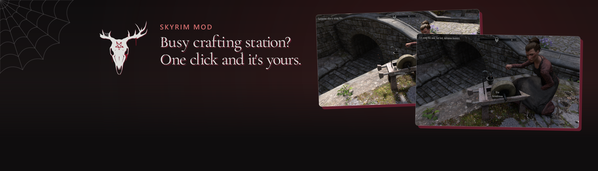
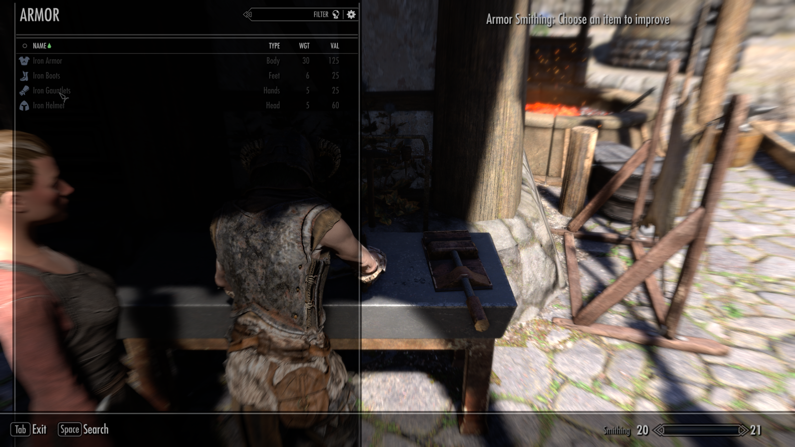
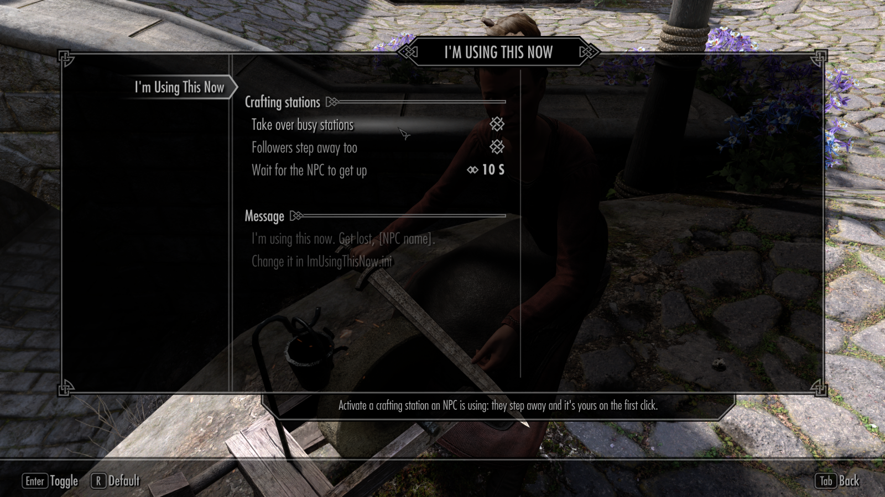

Click a crafting station an NPC is using and it's yours on the first click: they step away and the crafting menu opens. No more "Someone else is using this." and a second click.

<picture>
  <source media="(prefers-color-scheme: dark)" srcset="docs/divider.png">
  
</picture>

## How it works

- **One click.** Forge, workbench, grindstone, tanning rack, alchemy lab, enchanter: if an NPC is using it, they get up and the menu opens for you as soon as the station is free, usually within two to four seconds.
- **You say so.** Instead of "Someone else is using this." you see "I'm using this now. Get lost, Adrianne Avenicci." with whoever you just moved along.
- **Busy NPCs keep their station.** Anyone in a scene, a conversation or combat, or doing quest work, is left alone, and you get the game's usual message.
- **Then life goes on.** When you leave, the NPC goes back to work, as they would in the base game.

 <i>The line you see on your first click, instead of the game's "Someone else is using this."</i>

 <i>The same click opens the smithing menu while Adrianne stands aside, with no second try.</i>

## Install

1. Install with your mod manager.
2. The installer asks how you want to change the settings: in an MCM menu, or in an ini file with no plugin at all. If you have SkyUI, the menu is already picked.

**Needs:** SKSE, Address Library for SKSE Plugins, and the Microsoft Visual C++ 2015-2022 redistributable (x64). SkyUI for the menu.

**Tested on:** SE (1.5.97) and AE (1.6.640, 1.6.1170 and 1.7.104).

## Choose what it does

In MCM, open **I'm Using This Now**. Changes apply at once and hold for every save. Without MCM, edit `Data\SKSE\Plugins\ImUsingThisNow.ini`.

- **Take over busy stations:** on or off. Off is the base game.
- **Followers step away too:** on, your followers give up a station for you like anyone else; off, they keep using it.
- **Wait for the NPC to get up:** 1 to 60 seconds (10 by default). If they haven't got up by then, the station stays theirs.
- **Your own message:** write any line you like in the ini (`sMessage`). `{name}` becomes the NPC's name.

 <i>The MCM page: turn it off, leave followers alone, or change how long to wait for the NPC.</i>

## Good to know

- After an NPC gets up, they wait beside the station until you're done, so you may stand close together for a moment. The base game does the same when you take a free station an NPC wants.
- The ini-only choice adds no plugin, so it can be added or removed at any time. The MCM choice adds one ESL-flagged plugin that takes no load order slot.
- No scripts run in the background. The MCM choice only has the menu's own script.

Build it yourself

- **DLL:** `dll\build.bat` with Visual Studio 2022 Build Tools and xmake; CommonLibSSE-NG is the `dll\lib\commonlibsse-ng` submodule.
- **MCM files:** `mcm\build.ps1 -Game <Skyrim SE folder> -SkseSource <SKSE's Scripts\Source>` with the Creation Kit's Papyrus compiler, SkyUI's `SKI_ConfigBase`, `SKI_ConfigManager` and `SKI_QuestBase` sources, SKSE's script sources and the game's `Scripts.zip`; `mcm\make_plugin.py` writes the plugin.
- **Package:** `python package\make_release.py . dist\build`.

## Report a problem

Post in the Nexus page's Bugs tab with your game version and what you saw, or find me on [Discord](https://discord.com/invite/sayngwyn). The log is `Documents\My Games\Skyrim Special Edition\SKSE\ImUsingThisNow.log`.

---

**Credits**

- **SKSE team** for SKSE.
- **meh321** for Address Library for SKSE Plugins.
- **CommonLibSSE-NG** for the library it's built on (Ryan-rsm-McKenzie, CharmedBaryon, alandtse and contributors).
- **SkyUI team** for SkyUI and its mod menu.

Made with AI. Claude contributed heavily under my direction: I decided what it does and checked it, and the AI wrote most of the code, its tests and these docs.

## Licence

GPL-3.0 (see `LICENSE`, with the exceptions in `dll\EXCEPTIONS`).
